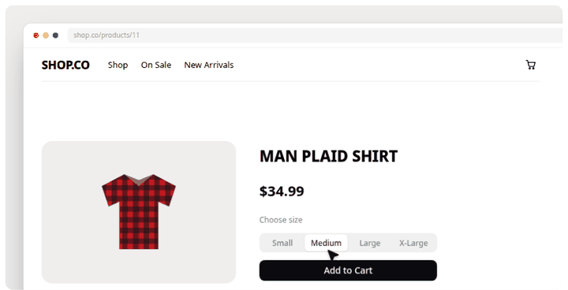
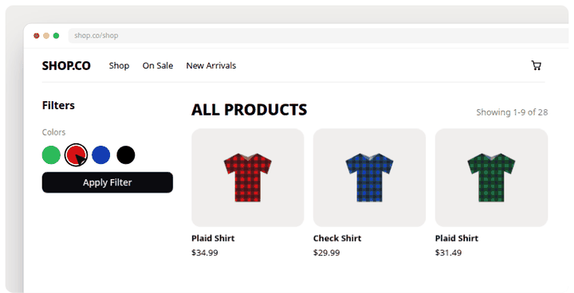

# Shop.co

A hobby clothing store: browse and filter products, pick a size, keep a cart, sign up, check out and see your orders. The design follows the free [E-commerce Website Template](https://www.figma.com/community/file/1273571982885059508) from the Figma community. There are no payments: checkout just records the order.

## Demos

Made with the [stageshow](.agents/skills/stageshow) kit (faux UI, so they are illustrations, not screen recordings).

| Shop, cart, order | Filter the shop |
| :---: | :---: |
|  |  |

Run them live with `pnpm demo` (opens on `localhost:5191`).

### Full walkthrough video

[docs/walkthrough/shop-walkthrough.mp4](docs/walkthrough/shop-walkthrough.mp4) is a 2 min 15 s tour of the **real running site** (browse, search and filters, phone view, product, cart and promo code, sign up, checkout, orders, review, saved cart). The storyboard and how to remake it are in [docs/walkthrough/STORYBOARD.md](docs/walkthrough/STORYBOARD.md).

## What it does

- **Shop:** home page, product listing with filters, sort, search and pagination (all kept in the URL), product page with gallery, sizes, colors, reviews and related items.
- **Accounts:** sign up, log in, log out (cookie login, hashed passwords). Logged-in users can write one review per product.
- **Cart:** saved in the browser; when you are logged in it is also saved on the server and merged when you log in.
- **Checkout:** delivery details, promo code `SHOP20` (20% off), order history and order details.

## Stack

| Part | Tech |
| --- | --- |
| `apps/web` | React 19, Vite, Tailwind 4, React Router |
| `apps/api` | Express 5, PostgreSQL (`pg`), zod, JWT cookie, bcrypt |
| `packages/shared` | Types and zod schemas used by both |
| `apps/demo` | The stageshow demos |
| `apps/video` | The walkthrough video (Remotion) |
| Database | Postgres 17 in Docker |

pnpm monorepo, TypeScript everywhere.

## Run it

Needs Node 22+, pnpm and Docker.

```sh
cp .env.example .env     # set JWT_SECRET to any long random string
pnpm install
pnpm db:up               # Postgres in Docker (host port 5433)
pnpm db:reset            # create the tables and load demo products
pnpm dev                 # web on :5173, api on :3000
```

Other commands: `pnpm demo`, `pnpm test`, `pnpm typecheck`, `pnpm lint`, `pnpm build`, `pnpm db:down`.

## How the backend is laid out

```
apps/api/
  db/schema.sql     # every table, hand-written (edit it, then pnpm db:reset)
  db/seed.sql       # demo data
  src/index.ts      # app setup, mounts the routers
  src/routes/       # URL -> controller
  src/controllers/  # request handling and SQL
  src/middleware/   # requireAuth
```

API routes are listed in [docs/api-routes.md](docs/api-routes.md), page routes in [docs/routing.md](docs/routing.md).

## Notes

- Product photos come from a public demo catalogue (shirts and dresses only), so the grid repeats.
- `apps/demo/src/kit` is a copy of the stageshow kit (MIT, see its `LICENSE`).
